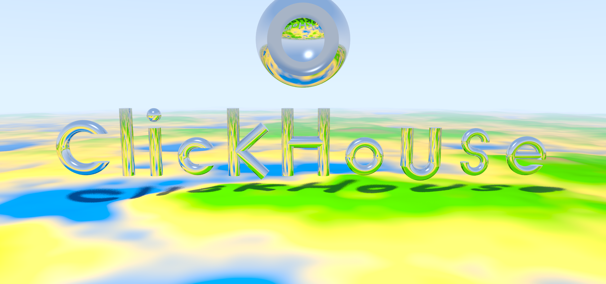
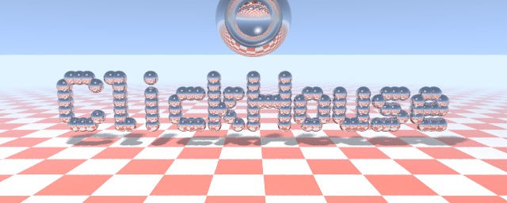
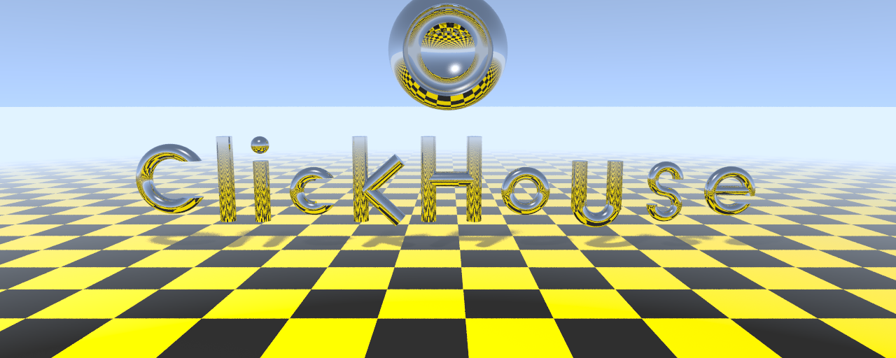
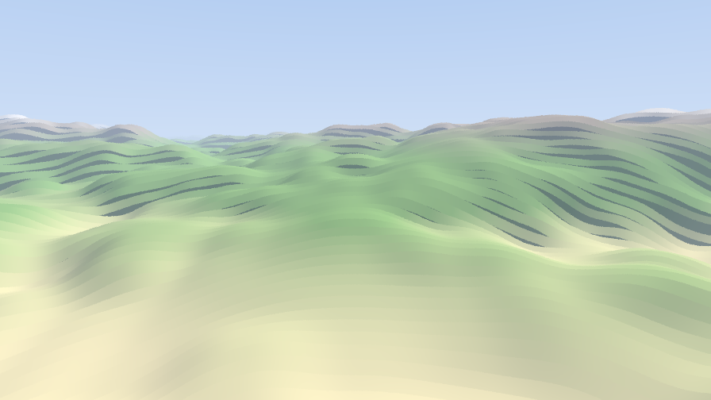

# RayTracer — a ray tracer in ClickHouse SQL



A path tracer written entirely as **ClickHouse SQL queries**, rendering straight to a PNG
via ClickHouse's `PNG` output format. No UDFs and no external code — a single `SELECT`
computes every pixel.

It renders the word **ClickHouse** as glassy, chrome lettering — in the spirit of Andrew
Kensler's famous Pixar business-card ray tracer — and, in the scene above, sets it floating
over a procedurally generated landscape, reflecting the terrain and casting shadows on the hills.

See also:
- [NoiSQL — Generating Music With SQL Queries](https://github.com/ClickHouse/NoiSQL)
- [SQL Mandelbrot Benchmark](https://github.com/ClickHouse/sql-mandelbrot-benchmark)
- [DOOMHouse is a "Doom-like" game engine that renders the 3D graphics entirely in ClickHouse SQL](https://github.com/arniwesth/DoomHouse)

## How it works

The whole renderer lives in one query:

- **Pixels are rows.** `numbers_mt(width * height * samples)` produces one row per
  `(pixel, sample)`; the output columns `r, g, b` (in `[0, 1]`) are written to the `PNG`
  output format in scanline order, and samples are averaged with `GROUP BY pixel`.
- **3D math on tuples.** Vectors are `Tuple(Float64, Float64, Float64)`; `dotProduct`,
  `L2Normalize`, `tuplePlus`, `tupleMultiplyByNumber`, … do the linear algebra, wrapped in
  short lambda aliases (`va`, `vs`, `vm`, `vd`, `vn`, `vc`, `vref`).
- **The bounce loop is `arrayFold`.** Every ray is advanced exactly one mirror bounce per
  fold step over `range(maxDepth)` — a loop *inside each row*, so rows stay independent and
  the render parallelizes across all CPU cores. (The first version used a `WITH RECURSIVE`
  CTE instead — see the queries below.)
- **`let`-bindings via `arrayMap`.** ClickHouse `WITH` lambdas are call-by-name, so passing a
  value as a parameter re-expands the expression and blows up the query tree. Intermediates
  are therefore bound *by value* with `arrayMap(x -> body, [expr])[1]`, a one-element-array
  "let".

### Geometry (Constructive Solid Geometry)

- **Cylinders** — round rods with flat caps for the straight strokes (`l`, `i`, `k`, `H`,
  `u`, the bar of `e`).
- **Tori** — the round letters (`C`, `c`, `o`, `u`, `s`, `e`), ray-**marched** through their
  signed-distance field; the openings of `C`/`c`/`s`/`e` are a box subtracted from the ring.
- **Spheres** — the dot on `i`, plus a chrome "planet" that is a sphere **minus** a sphere.
- **Oriented boxes / parallelepipeds** — available for flat-faced strokes.

So the scene exercises boxes, cylinders, tori and spheres, with CSG **union**, **difference**
(the planet and the letter openings) and a **ray-marched distance field** (the tori).

### Terrain

A height field `z = amp · fBm(x, y)`, where fBm sums several octaves of lattice value-noise.
Camera rays are ray-marched against it — the march skips the empty air (it starts where the
ray first drops to the terrain's maximum height) and linearly interpolates the surface
crossing, so it is both fast and free of step-banding. It is shaded with a height color ramp
(water → sand → grass → rock → snow), a warm sun plus cool sky-ambient model, marched shadows
(terrain self-shadow *and* the letters' cast shadows), and distance fog into the sky.

## Gallery

| | |
|---|---|
|  |  |
| **Pixar homage** — the letters as a union of sphere primitives, chrome over a checkerboard. | **CSG primitives** — the letters carved from cylinders, tori and spheres. |
|  |  |
| **Perlin terrain** — a standalone ray-marched height field. | **Combined** — ClickHouse over the terrain (the hero image above). |

## Running

Every file in [`queries/`](queries) is complete and self-contained. Render one with:

```bash
clickhouse local --queries-file queries/clickhouse_terrain.sql > out.png
```

| Query | Scene | Resolution |
|---|---|---|
| [`clickhouse_raytracer.sql`](queries/clickhouse_raytracer.sql) | Pixar homage, `WITH RECURSIVE` bounce loop | 640 × 256 |
| [`clickhouse_raytracer_loop.sql`](queries/clickhouse_raytracer_loop.sql) | Same scene, `arrayFold` loop (parallel, faster) | 640 × 256 |
| [`clickhouse_raytracer_primitives.sql`](queries/clickhouse_raytracer_primitives.sql) | Letters carved from CSG primitives | 1280 × 512 |
| [`terrain.sql`](queries/terrain.sql) | Perlin-noise terrain | 896 × 504 |
| [`clickhouse_terrain.sql`](queries/clickhouse_terrain.sql) | ClickHouse over the terrain (hero image) | 2560 × 1200 |

The queries are emitted by the parameterized Python generators in [`generators/`](generators)
(resolution, samples-per-pixel and bounce depth are command-line arguments). For example,
to re-create the hero image:

```bash
python3 generators/gen_combined.py 2560 1200 8 2 > scene.sql
clickhouse local --queries-file scene.sql > scene.png
```

## Credits

Inspired by Andrew Kensler's *business-card ray tracer* and Paul Heckbert's minimal ray
tracers — re-imagined as pure ClickHouse SQL.

## License

[Creative Commons Attribution-NonCommercial-ShareAlike 4.0](LICENSE), the same license as
[ClickBench](https://github.com/ClickHouse/ClickBench).
