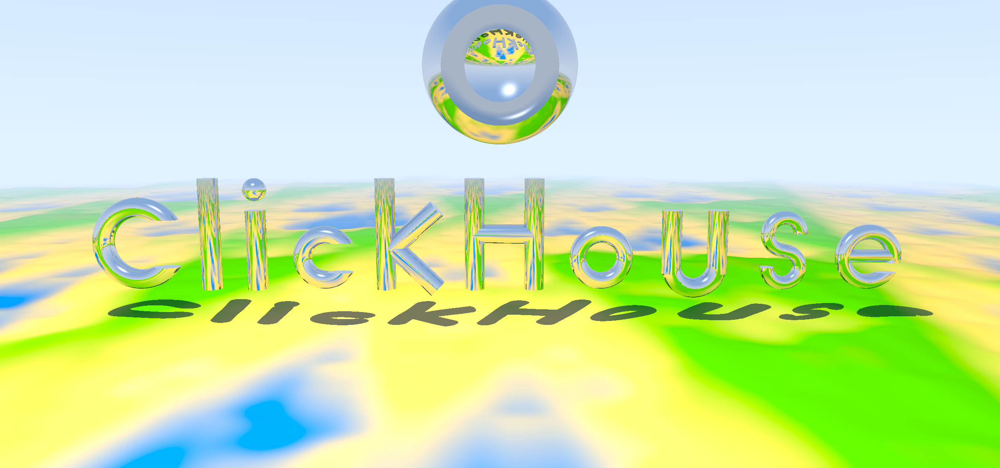

# Cross-engine benchmark

Porting the combined **ClickHouse-over-terrain** scene to other SQL engines, checking that
each renders the *same* image, and measuring how long each takes.

## The scene

A deterministic version of [`../queries/clickhouse_terrain.sql`](../queries/clickhouse_terrain.sql),
benchmarked at **full resolution — 2560 × 1200 (3.07 M pixels), 1 centred sample per pixel,
2 bounce depth** (the hero-image size). The queries are parameterised, so any resolution can be
generated.

- **Deterministic**: no anti-alias jitter, no soft-shadow jitter (the light is a fixed point),
  so every engine should produce identical pixels up to floating-point rounding.
- **Portable hash**: the terrain noise uses a hand-rolled integer LCG hash (two rounds, all
  intermediates below ~9.2e18 so it never overflows signed 64-bit and never errors in
  Postgres/MySQL) instead of `cityHash64`/`intHash64`, so the *terrain matches across engines*.

Every engine emits one row per pixel — `idx \t R \t G \t B` (0–255, scanline order). That
uniform dump is what we diff and render; only ClickHouse can also emit a real PNG.

## Layout

```
benchmark/
├── gen_clickhouse_bench.py   # emits the ClickHouse query (portable hash, PNG or TSV output)
├── gen_cedardb_bench.py      # emits the CedarDB recursive-CTE port (args: W H DEPTH)
├── gen_duckdb_bench.py       # emits the DuckDB port (does not compile; kept as evidence)
├── primfont2.py              # the glyph geometry (shared)
├── tools.py                  # render a TSV dump to PNG; diff two dumps for correctness
├── FINDINGS.md               # the cross-engine portability write-up
├── queries/                  # the generated per-engine queries
│   ├── clickhouse.sql
│   └── cedardb.sql
└── out/                      # full-resolution renders (2560x1200)
    ├── clickhouse_full.png   # the reference image
    └── cedardb_full.png      # the CedarDB render (visually identical)
```

## Running

```bash
# ClickHouse reference (pixel dump + image), full resolution
python3 gen_clickhouse_bench.py 2560 1200 2 data > queries/clickhouse.sql
clickhouse local --queries-file queries/clickhouse.sql > out/clickhouse.tsv
python3 tools.py render out/clickhouse.tsv 2560 1200 out/clickhouse_full.png

# CedarDB port (Postgres wire protocol; here on host port 5499)
python3 gen_cedardb_bench.py 2560 1200 2 > queries/cedardb.sql
psql -h 127.0.0.1 -p 5499 -U postgres -d raytracer -q -f queries/cedardb.sql > out/cedardb.tsv
python3 tools.py render out/cedardb.tsv 2560 1200 out/cedardb_full.png

# Compare an engine's dump against the reference
python3 tools.py compare out/clickhouse.tsv out/cedardb.tsv
```

## The image

Full resolution (2560 × 1200), rendered by **CedarDB** in 9 min 40 sec — visually identical to the ClickHouse result rendered in 18 sec.
reference:



## Status & notes

| Engine | Port approach | Status |
|---|---|---|
| **ClickHouse** | `arrayFold` + `arrayMap` lambdas + tuple math | ✅ reference; **fastest** (all cores, no `ORDER BY` pin, `optimize_and_compare_chain = 0`; see finding 1) |
| **CedarDB** | recursive-CTE marches + set-based hits + SQL functions | ✅ matches reference; compiles & runs (see below) |
| **DuckDB** | `CREATE MACRO` + `list_reduce`/`list_transform` | ❌ planner can't compile a multi-march query — fails at *any* size, including 192 × 90 (see below) |
| **Postgres** | no SQL lambdas/HOFs → recursive CTE / PL/pgSQL | not started (procedural) |
| **MySQL** | no arrays/lambdas → recursive CTE / stored routines | not started (procedural) |

### Results (full resolution: 2560 × 1200, depth 2, same machine)

| Engine | Wall time | cores used |
|---|---:|---:|
| ClickHouse | **17.8 s** | ~64 (6398 % CPU) |
| CedarDB | **9 min 40 s** (580 s) | ~92 |
| DuckDB | **does not compile** — fails at any size, even 192 × 90 | — |

Same scene, same image (byte-identical pixel sums; visually identical — see
`out/clickhouse_full.png` and `out/cedardb_full.png`).

**ClickHouse is ~33× faster than CedarDB here** — its vectorised execution outruns CedarDB's
row-at-a-time recursive-CTE marches by a wide margin once two artefacts are removed (findings 1
& 2): the `optimize_and_compare_chain` analysis blow-up (`SETTINGS optimize_and_compare_chain =
0`) and an `ORDER BY` that pinned the whole render to one core. With the defaults (analysis pass
on, `ORDER BY pixel`, `max_threads = 24`) the same render took ~11 min — almost all of it
artefact, not ray-tracing. DuckDB never enters the comparison: its planner cannot compile a
query with more than one ray-march at *any* resolution.

CedarDB's standing is unchanged in kind: its win is that it **compiles** this scene at all (the
recursive-CTE shape DuckDB can't plan) — not raw throughput.

### Findings

> A full, self-contained write-up of the cross-engine portability study is in
> [`FINDINGS.md`](FINDINGS.md). The summary below is the short version.

**1. ClickHouse's analysis cost was almost entirely one default-on optimizer pass —
`optimize_and_compare_chain`.** Profiling showed ~80 % of query *analysis* in
`IQueryTreeNode::getTreeHash` (an uncached, whole-subtree walk). It is driven by
`LogicalExpressionOptimizerPass::tryOptimizeAndCompareChain`, which inserts every `AND`-chain
comparison's operands into hash maps keyed by their full tree hash. This scene has many `AND`
validity checks (`hh>=0 AND aa>1e-9 AND t>eps AND y>0 AND y<baba`) whose operands are huge
let-expanded subtrees, so the pass hashes a large fraction of the (exponentially expanded)
tree — and folds nothing. Disabling it (`SET optimize_and_compare_chain = 0`) cuts a 16 × 16
render from **~72 s to ~2.3 s (~30×)** with an identical image, and saves ~99 s at full
resolution. The benchmark query sets it, so ClickHouse's time here is real ray-tracing
throughput rather than a pathological analysis cost. (The underlying engine improvement — bound
that pass's hashing work — is a separate ClickHouse change.)

**1b. `ORDER BY pixel` pinned the whole render to one core.** Even with the analysis cost gone,
the full-resolution render took ~11 min at ~100 % CPU (one core). The optimizer inlines the
nested subqueries, so the outer `ORDER BY pixel` makes ClickHouse evaluate the heavy per-pixel
ray-trace in the *single-stream post-sort projection* (`MergingSortedTransform 62 → 1`) — the
embarrassingly-parallel compute ran serially. The TSV dump is keyed by `idx` in `tools.py`, so
it needs no ordering; dropping `ORDER BY` (and not pinning `max_threads`) lets the per-pixel
compute run on all cores. **Effect: 655 s → 17.8 s (~37×) at ~6400 % CPU (~64 cores)**,
byte-identical image. (PNG output keeps `ORDER BY`, since it writes pixels in scanline order.)
With both fixes, ClickHouse's vectorised execution renders the scene ~33× faster than CedarDB.

**2. The DuckDB port works piece-by-piece but the *whole* renderer overwhelms DuckDB's
planner.** `gen_duckdb_bench.py` faithfully translates the scene (tuples→`LIST`, lambdas→
`MACRO`, `arrayFold`→`list_reduce`, the portable hash, etc.) and the individual pieces run and
match: `terrH`, `toriSDF`, `marchTorus` (0.4 s), `marchTerr` (a single ray ≈ 6.5 s bind +
~17 ms/ray, so it vectorises). But assembling them into one `oneBounce` expression does not
bind — a single `oneBounce` evaluation runs >110 s at ~14 GB and never returns. DuckDB
macros are call-by-name, and even with the marched point bound via a one-element
`list_transform`, the fully-expanded per-bounce expression is too large for DuckDB's
binder/optimizer. (ClickHouse's analyzer *does* compile the equivalent monolith, in ~50 s —
that contrast is itself a result.)

I then re-architected it: each bounce as a `MATERIALIZED` CTE, the per-bounce step as a flat
SELECT using DuckDB's by-value **lateral column aliasing** (verified: an alias referenced 4×
binds once). Memory no longer blows up (~1 GB, not 14 GB) — but it still doesn't **plan**:

| what | time |
|---|---|
| one `marchTerr` (a single ray-march, scalar) | ~6.7 s |
| `marchTerr` **+** `marchTorus` in one query | **> 150 s (timeout)** |
| `EXPLAIN` of a single bounce (planning only, no execution) | **> 280 s (timeout)** |

So DuckDB's optimizer is **superlinear — effectively exponential — in the number of
macro-expanded `list_reduce` marches in a single query**. One march is fine; two already blow
up. The combined scene needs ~4 marches per bounce (terrain, tori, the shadow's terrain and
tori marches) × 2 bounces ≈ 8 marches, which DuckDB cannot plan in any formulation tried
(monolith, staged-flat, per-march CTEs all plan the whole query together).

**Bottom line:** DuckDB's planner cannot compile this renderer once more than one ray-march is
involved — because its `list_reduce` march is an *expression*, and nesting several of them
blows up the expression the planner must analyse. This is resolution-independent: it fails at
192 × 90 exactly as it fails at full resolution — the scene never compiles, so there is no
pixel count small enough to make it run. (CedarDB, which expresses the same marches as
*recursive CTEs* — relations, not expressions — has no such problem; see finding 3.) The
only remaining DuckDB avenue is to split the renderer into ~20 *separate* `CREATE TABLE … AS`
statements (≤ 1 march each, materialised to real tables between them) — possible, but
non-idiomatic and with unknown execution speed.

**3. CedarDB compiles *and* runs the whole scene via recursive CTEs** (slower than ClickHouse's
vectorised engine — 580 s vs 17.8 s — but, unlike DuckDB, it runs at all). CedarDB has
no SQL lambdas either, so the port is a different shape: vectors are `double precision[]`,
leaf math is `CREATE FUNCTION` expression-bodies, intersection math lives in `LATERAL` "let"
chains in the main query, and every ray-march is a `WITH RECURSIVE` that advances all rays in
lockstep. The bounce loop is unrolled (a recursive CTE can't be nested in another), so depth-2
is two march pipelines; the full query carries **six recursive marches** (terrain + tori, ×
primary and shadow, × two bounces) plus the analytic letters and planet — and CedarDB's
planner handles it without complaint, rendering the full 2560 × 1200 scene in ~9 min 40 s
(≈ 189 µs/pixel). The render matches the ClickHouse
reference (mean per-channel diff ≈ 1.0; the handful of pixels that differ by more are
silhouette / shadow-boundary pixels, the inherent sub-pixel disagreement of two independent
ray tracers without anti-aliasing). This is the crisp contrast with DuckDB: the *recursive
CTE* is a relation (data-level iteration with a bounded per-step body), so the planner never
faces the exponential expression blow-up that defeats DuckDB's macro expansion. Full write-up
in [`FINDINGS.md`](FINDINGS.md). One genuine CedarDB engine bug found along the way and
reported upstream ([cedardb/issues#71](https://github.com/cedardb/issues/issues/71)):
subscripting a `CASE`-produced array under `ORDER BY` aborts the server (worked around with
`mix()` blends). (`LATERAL` in a recursive term, which I first suspected, turned out to work
fine — that crash was the same `CASE`-array bug.)

**4. Postgres / MySQL have no lambdas *and* no advanced recursive planner.** A faithful port
still needs a recursive-CTE reformulation of every loop, but without CedarDB's planner the
six-march query is a much riskier bet; these remain the procedural / recursive-CTE frontier.
