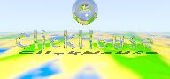

# Cross-engine benchmark

Porting the combined **ClickHouse-over-terrain** scene to other SQL engines, checking that
each renders the *same* image, and measuring how long each takes.

## The scene

A small, deterministic version of [`../queries/clickhouse_terrain.sql`](../queries/clickhouse_terrain.sql):

- **192 × 90**, 1 centred sample per pixel, 2 bounce depth — small on purpose, so even slow
  engines finish in reasonable time.
- **Deterministic**: no anti-alias jitter, no soft-shadow jitter (the light is a fixed point),
  so every engine should produce identical pixels up to floating-point rounding.
- **Portable hash**: the terrain noise uses a hand-rolled integer LCG hash (two rounds, all
  intermediates below ~9.2e18 so it never overflows signed 64-bit and never errors in
  Postgres/MySQL) instead of `cityHash64`/`intHash64`, so the *terrain matches across engines*.

Every engine emits one row per pixel — `idx \t R \t G \t B` (0–255, scanline order). That
uniform dump is what we diff and render; only ClickHouse can also emit a real PNG.

## Layout

```
benchmark/
├── gen_clickhouse_bench.py   # emits the ClickHouse query (portable hash, PNG or TSV output)
├── primfont2.py              # the glyph geometry (shared)
├── tools.py                  # render a TSV dump to PNG; diff two dumps for correctness
├── queries/                  # the generated per-engine queries
│   └── clickhouse.sql
└── out/                      # rendered images and pixel dumps
    ├── clickhouse.tsv        # the reference pixel dump
    └── clickhouse_192.png    # the reference image
```

## Running

```bash
# ClickHouse reference (pixel dump + image)
python3 gen_clickhouse_bench.py 192 90 2 data > queries/clickhouse.sql
clickhouse local --queries-file queries/clickhouse.sql > out/clickhouse.tsv
python3 tools.py render out/clickhouse.tsv 192 90 out/clickhouse.png

# Compare another engine's dump against the reference
python3 tools.py compare out/clickhouse.tsv out/duckdb.tsv
```

## The reference image (192 × 90)



## Status & notes

| Engine | Port approach | Status |
|---|---|---|
| **ClickHouse** | `arrayFold` + `arrayMap` lambdas + tuple math | ✅ reference |
| **DuckDB** | `CREATE MACRO` + `list_reduce`/`list_transform` + `LIST`/`STRUCT` | in progress |
| **Postgres** | no SQL lambdas/HOFs → needs recursive CTE / PL/pgSQL | hard |
| **CedarDB** | Postgres-compatible, same constraint | hard |
| **MySQL** | no arrays/lambdas → needs recursive CTE / stored routines | hard |

Findings so far:

- **ClickHouse time is dominated by query *analysis*, not pixel compute.** This query is a
  deeply nested tree of ~30 lambdas; expanding it takes ~50 s regardless of resolution
  (16×16 ≈ 50 s, 192×90 ≈ 60 s). So at low resolution the ClickHouse number is mostly a
  fixed planning cost, not ray-tracing throughput.
- The renderer leans entirely on **higher-order array functions and lambdas**. DuckDB has
  equivalents (`list_reduce`, `list_transform`, scalar `MACRO`s), so the port is mechanical.
  Postgres / CedarDB / MySQL have no lambdas in SQL, so a faithful port needs procedural code
  (PL/pgSQL functions or stored routines) — a much larger undertaking.
